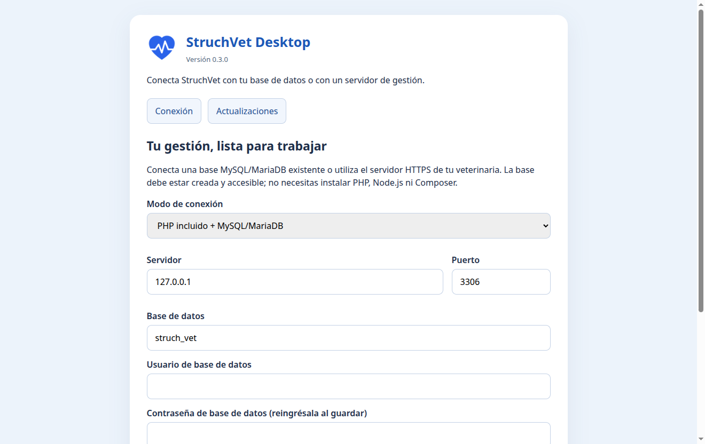
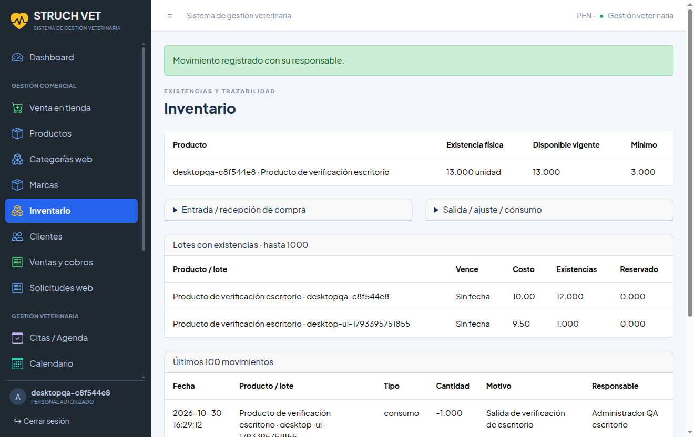

# StruchVet

Sistema de gestión veterinaria con inventario, ventas, agenda clínica y tienda web. **StruchVet Desktop** incorpora la gestión PHP en una aplicación Electron independiente, con runtime PHP incluido, configuración guiada, respaldos y actualizaciones mediante GitHub Releases.

El proyecto conserva tres aplicaciones separadas:

| Carpeta | Aplicación | Tecnologías |
| --- | --- | --- |
| `gestion/` | Inventario, caja, clientes, mascotas, consultas, citas y administración | PHP, PDO, MariaDB/MySQL, Twig, CoreUI |
| `web/` | Catálogo, ofertas, carrito y solicitudes de pedidos/citas | Astro, TypeScript |
| `electron/` | Cliente de escritorio y distribución de Gestión | Electron, electron-builder, electron-updater |

El corazón azul original se utiliza en la ventana, accesos directos e instaladores. El ecommerce continúa ejecutándose independientemente.

## Capturas reales

Asistente del paquete 0.3.0 e inventario con un producto temporal de la base de pruebas, capturados en Fedora KDE. No son maquetas.





## Estado de distribución

Versión de trabajo: **0.3.0**. Los artefactos construidos localmente se encuentran en `electron/dist/`; no se incluye información de clientes en ellos. Consulta [la validación de escritorio](docs/VALIDACION-DESKTOP.md) para distinguir plataformas probadas, formatos construidos y pendientes. No se ha publicado una release estable con este cambio.

Los instaladores estarán disponibles en [GitHub Releases](https://github.com/MijahelPersonal/inventario-web-Veterinaria/releases) cuando se apruebe una publicación. Las compilaciones de CI se conservan como artefactos; los tags coincidentes con la versión producen un **borrador**, no una publicación estable automática.

## Instalación y conexión

**Linux:** AppImage, RPM y DEB. En AppImage, concede permiso de ejecución y abre el archivo. Desde **StruchVet → Instalar AppImage en este usuario** se crea una copia en `~/Applications/StruchVet/` y una entrada con icono en el menú de aplicaciones. RPM y DEB proporcionan sus entradas de menú mediante el gestor de paquetes de la distribución.

**Windows:** instalador NSIS `.exe` compilado correctamente en GitHub Actions sobre Windows 2022, junto con sus metadatos de actualización. Está en los [artefactos de la ejecución verificada](https://github.com/MijahelPersonal/inventario-web-Veterinaria/actions/runs/41132992374). Firma y prueba de instalación en Windows son requisitos previos a distribuir una versión estable.

**macOS:** icono ICNS y configuración DMG/ZIP preparados; falta integrar y verificar un runtime PHP relocatable y disponer de firma/notarización. La preparación rechaza macOS expresamente hasta entonces.

El usuario no necesita Node.js, Composer, Apache ni instalar PHP. El asistente ofrece dos conexiones:

1. **PHP incluido + MariaDB/MySQL existente:** un administrador proporciona servidor, base y credenciales. No se instala ni sustituye automáticamente el servidor de base de datos. La base debe estar creada y accesible. Los archivos subidos se conservan en este equipo.
2. **Servidor de Gestión HTTPS:** utiliza un servidor ya desplegado; no necesita base local. Una instalación en Internet requiere Internet para trabajar. Este modo centraliza datos e imágenes para varios puestos.

No se migra de MariaDB a SQLite ni se empaqueta una base de demostración. Las migraciones se confirman en pantalla, se respaldan las tablas existentes y se bloquean reintentos automáticos tras un fallo de DDL. Las instalaciones nuevas solicitan un primer administrador, sin contraseña predeterminada.

## Desarrollo

Requisitos del desarrollador: Node.js 22, Composer, PHP 8.3–8.5 y MariaDB/MySQL. Las extensiones PHP y los detalles de conexión están en [la guía técnica](docs/DESKTOP.md).

```bash
cd gestion
composer install
npm ci
npm run assets
cd ../electron
npm ci
npm run prepare:resources
npm run verify:resources
npm test
npm start
```

Para la web: desde `web/`, `npm ci` y `npm run dev`. Se mantienen sus propias variables y servidor; Electron no empaqueta ni levanta el ecommerce.

## Compilar y actualizar

```bash
cd electron
npm run build:linux
# En Windows:
npm run build:win
```

Los archivos de aplicación y el PHP se actualizan juntos. La configuración, sesiones, imágenes y respaldos se guardan en el perfil del usuario. El actualizador consulta versiones reales de GitHub, muestra versión/notas/progreso y requiere acciones explícitas para descargar e instalar. Antes de instalar se detiene el servicio local y se respaldan base, configuración e imágenes. No se confirman cobros ni se cambian datos de negocio por actualizar.

Para publicar, revisar [la guía técnica](docs/DESKTOP.md), [el protocolo de lanzamiento](.agents/skills/desktop-release/SKILL.md) y los resultados de [GitHub Actions](.github/workflows/desktop.yml). No crear tags ni publicar versiones estables sin validación de la plataforma y del mecanismo de actualización correspondiente.

## Agentes de desarrollo

[`AGENTS.md`](AGENTS.md) contiene las reglas compartidas. Hay cinco roles Codex registrados en `.codex/agents/`, guías de responsabilidad en `.agents/agents/` y doce especialidades en `.agents/subagents/`. Son instrucciones operativas para colaborar en el repositorio; no son servicios de IA instalados en la aplicación ni procesos que se ejecutan solos. Uso y límites: [Agentes](docs/AGENTES.md).

## Errores y contribuciones

Reporta errores en [GitHub Issues](https://github.com/MijahelPersonal/inventario-web-Veterinaria/issues) indicando versión, sistema operativo, pasos y resultado esperado. No adjuntes contraseñas, bases, respaldos ni información personal de clientes. Las capturas deben ocultar datos sensibles. Para fallos de seguridad, evita publicar detalles o credenciales en un issue público.

Autor: **MijahelPersonal**. Código de aplicación de uso reservado; las bibliotecas y el símbolo original tienen sus propias licencias, conservadas en los recursos correspondientes.
